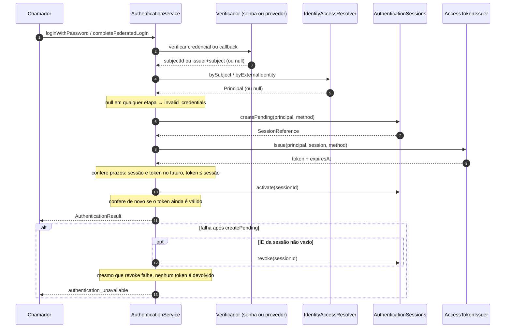

# Contratos públicos da Foundation — API major 1

Referência dos contratos que a Foundation expõe a módulos de negócio e a adapters técnicos. Descreve o que existe no código, as garantias que cada contrato exige de quem o implementa e o que continua pendente. Evidências de execução (comandos, resultados, ambiente) ficam em `openspec/changes/define-native-foundation-operational-core/validation.md`; o acompanhamento de tarefas fica em `tasks.md` da mesma mudança.

## 1. Propósito e público

A Foundation compõe infraestrutura operacional. Cada módulo de negócio mantém seu próprio Domain (BOs, VOs e regras), Application, Presentation/DTOs e adapters. O core oferece apenas domínio operacional (identidade, sessão), portas agnósticas, coordenação de autenticação e resolução de composição.

| Público | Usa |
| --- | --- |
| Módulo de negócio | Tipos e tokens de `foundation-api/contracts`; declara um `ModuleDescriptor`. |
| Adapter técnico (nativo ou externo) | Implementa as portas da seção 5 respeitando as garantias listadas. |
| Composition root do host | `foundation-api/nest` para registrar implementações no container Nest. |

Esta versão **não** entrega endpoint HTTP de login, de renovação ou de revogação, cadastro de credenciais, adapter real de hash de senha, provedor federado concreto (OIDC/OAuth) nem entrada pública de filas: `native/queue-bullmq` existe no código, mas ainda não está em `package.json#exports` nem no catálogo de composição. A telemetria (seção 8) e o build seletivo do artefato (`docs/selective-build.md`) existem e são descritos em suas próprias seções.

Os nativos entregues são persistência TypeORM com sessões compartilhadas (`native/persistence-typeorm`, `docs/persistence.md` e `docs/sessions.md`), auditoria durável (`docs/audit.md`), idempotência (`docs/idempotency.md`), storage S3 (`native/aws-s3`), e Redis para rate limit e readiness (`native/cache-redis`, `docs/admission.md`). Cada um só entra no grafo quando o host o importa ou o seleciona no perfil. JWT Auth deixou de ser nativo: é o módulo oficial `@devtrack-solution/jwt-auth` (`ext/jwt-auth`, seção 7.2.1), instalado pelo `api-cli` como extensão npm. Guard, contexto e tradução HTTP existem como mecanismos opt-in do Nest (seção 7.6).

## 2. Entrypoints

| Subpath | Conteúdo | Pode ser importado por |
| --- | --- | --- |
| `foundation-api/contracts` | Tipos, símbolos de injeção e classes/funções puras: `AuthenticationService` (login, federação, `refresh`, `revokeSession`), `PasswordCredentialsService`, `resolveComposition`, `createAuditContext`, `readAuditTrail`, `AuditReader`, `AUDIT_READ_PERMISSION`, `createAuditRetentionPolicy`, `decideRotation`, `ObjectStorage`, `ObjectStorageError`, `IdempotencyService`, `IdempotencyStore`, `InMemoryIdempotencyStore`, `canonicalJson`, `CompositionError`, `FOUNDATION_API_MAJOR`, e o contrato neutro de DTO `defineDtoSchema` / `getDtoSchema` (seção 6.9). | Application e camadas externas, respeitando a origem de cada contrato. Domain de módulo pode consumir somente tipos de Domain via `import type`; não depende de portas, serviços ou funções de Application. Não carrega Nest, ORM, SDK nem inicia servidor (verificado por `test:contracts`). |
| `foundation-api/nest` | `FoundationCoreModule` (`withAuthentication`, `withHttpSecurity`, `withAdmission`), os tipos de registro, `AuthenticationGuard`, `RequirePermissions`, interceptors, filter, pipe e `AsyncOperationContextStore`. | Somente Infrastructure/composition root. |
| `@devtrack-solution/jwt-auth` (pacote próprio) | `JwtAuthModule` (`register`, `registerAsync`), `JWT_AUTH_ISSUER`, `JWT_AUTH_VERIFIER`, `JwtAccessTokenAdapter`, tipos de configuração, `JwtAuthConfigError` e o descriptor em `./descriptor`. | Composition root do host (Nest), depois de `api-cli install`. Não faz parte do pacote `@devtrack-solution/foundation-api`. |
| `@devtrack-solution/swagger-adapter` (pacote próprio) | `SwaggerAdapterModule` (`register`, `registerAsync`), `SWAGGER_ADAPTER_DEFAULT_PATH`, tipos de configuração, `SwaggerAdapterConfigError` e o descriptor em `./descriptor`. | Composition root do host (Nest), via composição gerada depois de `api-cli install`. Não faz parte do pacote `@devtrack-solution/foundation-api`. |
| `foundation-api/native/opentelemetry` | `startOpenTelemetry`, `readOpenTelemetryConfig`, `createOpenTelemetryOperationSignals`, `OPEN_TELEMETRY_LIMITS` e `OpenTelemetryConfigError`. O bootstrap que inicia o SDK (`bootstrap.ts`) não faz parte do entrypoint. | Inicialização antecipada pelo arquivo gerado (seção 8). Não é exportado por `foundation-api/contracts`. |
| `foundation-api/native/persistence-typeorm` | `PersistenceTypeOrmModule` (`register`, `registerAsync`), `PERSISTENCE_DATA_SOURCE`, `PERSISTENCE_CONTRIBUTIONS` (catálogo da Foundation), `buildPersistenceCatalog`, `TypeOrmUnitOfWork`, `TypeOrmRepositoryBase`, configuração (`PersistenceConfigInput`, `persistenceConfigFromEnv`) e as implementações TypeORM de auditoria, idempotência e sessões (`docs/persistence.md`, `docs/audit.md`, `docs/idempotency.md`, `docs/sessions.md`). | Composition root do host (Nest) e módulos de negócio que declaram entidades `*.orm-entity.ts`. Não é exportado por `foundation-api/contracts`. |
| `foundation-api/native/aws-s3` | `AwsS3Module` (`register`, `registerAsync`), `AWS_S3_OBJECT_STORAGE`, `S3ObjectStorage`, `createS3ObjectStorage`, `resolveAwsS3Options`, tipos de configuração e `AwsS3ConfigError`. | Composition root do host (Nest). Não é exportado por `foundation-api/contracts`. |
| `foundation-api/native/cache-redis` | `CacheRedisModule.register`, `SHARED_RATE_LIMITER`, `REDIS_READINESS_CHECK`, `RedisRateLimiter`, `validateRedisCacheConfig` e `RedisCacheConfigError`, além de `CacheRedisModule.registerAsync` (seção 6.7). | Composition root do host (Nest), por registro manual em `FoundationCoreModule.withAdmission` ou por composição gerada. Não é exportado por `foundation-api/contracts`. |

Os subpaths `contracts`, `nest` e `native/*` estão declarados em `package.json#exports`. `main.js`, `AppModule` e arquivos internos não são exportados. O pacote continua `private`, versão npm `0.0.1`; essa versão é independente do major do contrato.

## 3. Convenções globais

- **Tempo:** todo timestamp público é epoch Unix em **milissegundos**, inteiro seguro (`Number.isSafeInteger`). O core lê o tempo apenas por `Clock`, injetado.
- **Identidade de injeção:** símbolos usam `Symbol.for('foundation.api.v1.<nome>')`, estáveis entre cópias compatíveis do pacote.
- **Falha fechada:** ausência de porta, resposta inválida de adapter ou exceção nunca habilitam caminho alternativo nem tornam uma operação pública.
- **Erros sanitizados:** exceções de adapters não são propagadas; o core as converte em códigos estáveis sem mensagem original.
- **Identidade interna:** `subjectId` é o identificador interno estável. Não é username, email nem subject de provedor externo.
- **Sem segredos em contratos de saída:** resultados não carregam senha, hash, token de provedor, perfil bruto ou claims de token.

## 4. Versão e compatibilidade

Fatos do código:

- `FOUNDATION_API_MAJOR = 1`. O resolvedor aceita apenas descriptors com `foundationApiMajor` igual a esse valor.
- Capacidades são comparadas por `id` e `major` inteiro exato. Não há interpretação de ranges SemVer.
- O namespace dos símbolos (`foundation.api.v1`) acompanha o major do contrato.

**API experimental:** a revisão C1–C3 de 09/11/2026 mantém o major 1 por autorização explícita, mesmo com as mudanças incompatíveis de C2 (`AuditEntry.context`) e C3 (registro Nest por portas nomeadas). Os consumidores locais e exemplos foram atualizados; não há promessa de compatibilidade com os contratos anteriores. Essa autorização não aprova a política de estabilidade da tarefa 1.1.

> **Política proposta, pendente de aprovação na tarefa 1.1:**
>
> - Após estabilização, mudança incompatível exige novo major e namespace: remover ou renomear export; tornar obrigatório um campo de entrada; remover ou alterar campo de saída de forma incompatível; mudar semântica de código de erro, unidade de tempo ou garantia de porta.
> - Adicionar campo obrigatório de saída **não é sempre compatível**: pode quebrar implementadores da interface, factories, mocks e consumidores que constroem esse objeto. Avaliar os dois lados do contrato e os testes de consumidores. C1 acrescenta `modules` obrigatório ao resultado experimental e exige atualização desses consumidores.
> - Acréscimo de export, campo opcional ou porta opcional pode ser compatível quando preserva comportamento e consumidores existentes. Novo membro de união, inclusive código de erro, pode quebrar tratamento exaustivo; não presumir compatibilidade apenas por ser uma adição.
> - Depreciação: marcar com `@deprecated` e registrar aqui por pelo menos uma versão minor antes da remoção no major seguinte.
> - Convivência de dois majors no mesmo host não é suportada nesta versão.

## 5. Catálogo de contratos

Status: **implementado** = código executável entregue e testado; **porta** = interface entregue. Quando a porta tem adapter nativo ou de Infrastructure, a coluna de status indica qual. Portas sem indicação de adapter não têm implementação nesta versão.

### 5.1 Domain operacional

| Contrato | Definição | Status |
| --- | --- | --- |
| `Principal` | `subjectId`, `tenantId?`, `permissions`. Vem sempre de resolver confiável, nunca do corpo da requisição. | Tipo |
| `AuthenticationMethod` | `{ kind: 'password' }` ou `{ kind: 'federated', providerId }`. | Tipo |
| `ExternalIdentity` | `providerId`, `issuer`, `subject` verificados. | Tipo |
| `SessionState` | `pending`, `active`, `revoked`, `expired`. | Tipo |
| `SessionReference` | `id`, `expiresAt`. | Tipo |

### 5.2 Segurança e sessões

| Contrato | Papel | Garantias exigidas do implementador | Status |
| --- | --- | --- | --- |
| `PasswordCredentialStore` | Busca registro por username. | Canonicaliza e garante unicidade do username; retorna `subjectId` + hash, nunca senha em claro. | Porta |
| `PasswordHashVerifier` | Verifica senha contra hash codificado. | Biblioteca de hash mantida; nunca igualdade simples. | Porta |
| `PasswordCredentialsVerifier` | Credencial → `{ subjectId }` ou `null`. | — | Implementado por `PasswordCredentialsService` |
| `FederatedIdentityProvider` | `begin` e `complete` de login externo. | Ver 7.3. Retorna só `issuer`/`subject` verificados ou `null`. | Porta |
| `IdentityAccessResolver` | `bySubject` e `byExternalIdentity` → `Principal` ou `null`. | `null` para conta ausente, bloqueada ou sem acesso. Vínculo externo exato; nunca cria conta nem casa por email. | Porta |
| `AuthenticationSessions` | `createPending`, `activate`, `revoke`. | Pendente é inutilizável por guards e expira mesmo após crash; `id` não vazio. `activate` é atômico `pending → active` e rejeita expirada/revogada. `revoke` é idempotente; o core só o chama com ID não vazio (ver 7.1). Recuperação com storage indisponível é do adapter. | Porta; adapter `TypeOrmAuthenticationSessions` (`native/persistence-typeorm/sessions`) |
| `AccessTokenIssuer` | Emite token da aplicação. | Formato privado do adapter; `expiresAt` nunca excede o da sessão. | Porta; adapter `JwtAccessTokenAdapter` (7.2.1) |
| `AccessTokenVerifier` | Token → `{ subjectId, sessionId, expiresAt }` ou `null`. | Verifica prova e validade do token. Não substitui consulta de sessão nem autorização. | Porta; adapter `JwtAccessTokenAdapter` (7.2.1) |
| `SessionReader` | `find(sessionId)` → referência + `subjectId` + `state`, ou `null`. | Storage compartilhado e autoritativo. Erro de leitura nunca equivale a sessão ativa. Sem cache positivo: cada chamada consulta o banco. | Porta; adapter `TypeOrmSessionReader` |
| `Clock` | `now()` em ms. | — | Porta |
| `RefreshTokenStore` | Rotação atômica (`rotate`), revogação de família (`revokeFamily`) e leitura do estado do refresh. | Rotação é uma operação única sob lock da sessão: CAS `active → consumed` com exatamente um sucessor. O store guarda só o digest do token. | Porta; adapter `TypeOrmRefreshTokenStore` |
| `RefreshTokenSecrets` | Gera o refresh opaco (256 bits) e calcula o digest. | Nunca JWT. Digest SHA-256; o token em claro não é persistido. | Porta; implementado por `NODE_REFRESH_TOKEN_SECRETS` |
| `AuthenticationService` | Coordena login por senha e federado, renovação (`refresh`, rotação D2) e revogação (`revokeSession`). | `refresh` exige `clientBinding` vindo do transporte confiável. Detalhes na seção 7.8. | Implementado |

### 5.3 Contexto, persistência, auditoria e execução

| Contrato | Papel | Garantias / restrições | Status |
| --- | --- | --- | --- |
| `OperationContext` | `correlationId`, `principal`, `deadlineAt`. | Construído por ingress confiável após autenticação, nunca a partir de headers brutos. Propagado por `AsyncLocalStorage` somente para rotas com guard (seção 7.6). | Tipo |
| `OperationContextAccessor` | `current()` devolve o contexto da operação ou lança `OperationContextUnavailableError`. | Porta; implementada por `AsyncOperationContextStore`. | Porta / implementado |
| `OperationAuthorizer` | Token bearer → `OperationContext`, com falha fechada. Consulta verifier, sessão, resolver e permissões. | Aplicação pura; usado pelo `AuthenticationGuard`. | Implementado |
| `AuditContext` / `createAuditContext` | Projeta `subjectId`, `correlationId` e `tenantId?` de `OperationContext`. | Copia somente os campos escalares permitidos, sem spread, permissões, deadline ou referências ao objeto de entrada. `tenantId` ausente/`undefined` é omitido; valor definido, inclusive string vazia, é preservado. Não valida identidade nem persiste dados. | Tipo / Implementado |
| `UnitOfWork<Resources>` | `run(work)` com recursos transacionais. | Confirma todos os recursos juntos ou desfaz; o trabalho não faz chamadas de rede. Sem `EntityManager` no use case. | Porta; adapter `TypeOrmUnitOfWork` |
| `AuditWriter` / `AuditEntry` | `append` de entrada durável: `id`, `occurredAt`, `context: AuditContext`, `action`, `target`, `outcome` (`succeeded`, `denied`, `failed`). | Destino durável e com acesso controlado; não substitui logs/telemetria. Sem payload arbitrário, credencial ou token de provedor. Writers futuros devem serializar apenas campos explicitamente permitidos; interfaces TypeScript não garantem ausência de propriedades extras em runtime. | Porta; adapter `TypeOrmAuditWriter` (valida por allowlist, `docs/audit.md`) |
| `AuditReader` | `readAuditTrail(reader, context, input)` lê a trilha de um tenant. | Exige `audit:read` (`AUDIT_READ_PERMISSION`) e tenant no principal. Limite de 1 a 100 entradas, janela `[fromMs, toMs)`, mais recente primeiro. Não há rota HTTP pública. Retenção por `createAuditRetentionPolicy` (padrão 365 dias) e purga `TypeOrmAuditRetention.purgeExpired`, que é a única via de DELETE. | Porta; adapter `TypeOrmAuditReader` e `TypeOrmAuditRetention` |
| `JobEnvelope<Payload>` | `id`, `type`, `payloadVersion`, `payload`, `subjectId`, `tenantId?`, `correlationId`, `deadlineAt`, `maxAttempts`, `traceContext?`. | Carrega referências de identidade, nunca bearer token; o executor reautoriza no momento da execução. `traceContext` é opcional (adição compatível) e leva somente `traceparent`/`tracestate` W3C, sem baggage (seção 8). | Tipo |
| `OperationSignals` | `recordActivity(name, outcome, durationMs)`, `runActivity(request, work)` e `injectTraceContext()`. Application pura, em `core/application/observability/`. | `runActivity` abre span, restaura o contexto de `traceContext` e registra desfecho e duração; falhas de `work` são propagadas sem alteração. Nome fora de `^[a-z][a-z0-9_.-]{0,63}$` vira `invalid`. | Porta; no-op por `createNoopOperationSignals` |
| `MetricsRecorder`, `SpanRecorder`, `TraceContextPropagator` | Portas que `createOperationSignals` recebe: contadores e histogramas, span filho do contexto ativo e injeção/extração W3C. | Sem tipos de OpenTelemetry. Atributos passam por `sanitizeSignalAttributes` (allowlist, seção 8). | Porta |

### 5.4 Composição

| Contrato | Papel | Status |
| --- | --- | --- |
| `ModuleDescriptor`, `ModuleSelection`, `ResolvedModuleSelection`, `CapabilityBinding`, `CompositionInput`, `ResolvedComposition` | Metadata de módulos e resultado da resolução. | Tipos |
| `resolveComposition` | Valida e resolve o grafo. | Implementado |
| `CompositionError` | Erro com `code` estável. | Implementado |
| Catálogo nativo (`src/core/application/modules/native-catalog.ts`) | Descriptors de `native/opentelemetry`, `native/http-security`, `native/aws-s3`, `native/cache-redis`, `native/persistence-typeorm` e `native/queue-bullmq`, metadata pura (seção 6.7). Fontes de import e pacotes de runtime em `src/core/infrastructure/composition/native-sources.ts`. | Implementado |
| Contrato neutro de DTO (`defineDtoSchema`, seção 6.9) | Descrição de propriedades de DTO em Application pura, sem Nest nem biblioteca de documentação. | Implementado |
| Perfil `config/composition.yaml` e leitor/validador | Seleção de natives e extensões, sem segredos. | Implementado |
| Gerador `npm run compose` | Gera `src/composition/composition.generated.ts` com imports estáticos. | Implementado |

### 5.5 Storage de objetos

| Contrato | Papel | Garantias exigidas do implementador | Status |
| --- | --- | --- | --- |
| `ObjectStorage` (`put`, `get`, `delete`, `signedReadUrl?`) | Porta de object storage. Chaves com prefixo `tenants/<tenant>/` (`assertTenantObjectKey`, `src/core/application/storage/object-key.ts`). | `put` sobrescreve a chave e falha com `object_too_large` antes de gravar qualquer byte. `get` ausente falha com `object_not_found`. `delete` de chave ausente é idempotente. Nenhum objeto é público. | Porta; adapter `S3ObjectStorage` (`native/aws-s3`) |
| `ObjectStorageError` | Erro neutro com código estável: `object_not_found`, `storage_unavailable`, `object_too_large`, `invalid_object_key`, `invalid_content_type`, `invalid_object_body`. | Mensagem fixa; nunca carrega a chave nem o conteúdo. | Implementado |

O adapter S3 usa a cadeia padrão de credenciais do SDK: credenciais não entram em configuração do host. A criptografia no servidor é obrigatória (padrão SSE-S3, `AES256`). Limites padrão: 10 MiB por objeto (teto de 100 MiB), `contentTypeAllowlist` com `image/png`, `image/jpeg` e `image/webp`, timeout de 5 s e até 3 tentativas.

### 5.6 Idempotência

| Contrato | Papel | Garantias / restrições | Status |
| --- | --- | --- | --- |
| `IdempotencyService` | `execute(context, operation, clientKey, payload, run)`. | Revalida `authorize` em toda chamada, inclusive em replay. Classifica falhas de `run` em retryable, terminal ou unknown. Detalhes em `docs/idempotency.md`. | Implementado (tarefa 4.1) |
| `IdempotencyStore` | `begin`, `complete`, `fail`, `find` e `purgeExpired`. | `begin` é atômico. `complete` e `fail` só alteram registro `in_progress` com o `claimToken` vigente; caso contrário lançam `idempotency_claim_lost`. | Porta; adapters `InMemoryIdempotencyStore` e `TypeOrmIdempotencyStore` |
| `IdempotencyCrypto` | Hash e geração de tokens. | Application não importa `node:crypto`. | Porta; implementado por `NODE_IDEMPOTENCY_CRYPTO` (Presentation) |

Não existem ainda fencing, heartbeat, outbox nem atomicidade com o `UnitOfWork` de negócio: são a tarefa 4.2 (`docs/idempotency.md`, seção "Limites e 4.2").

### 5.7 Admissão, rate limit e readiness

| Contrato | Papel | Garantias / restrições | Status |
| --- | --- | --- | --- |
| `AdmissionLimits` / `AdmissionGate` | Até `maxInFlight` requisições em processamento; fila de até `maxQueue` esperas com prazo `maxQueueWaitMs`. | Rejeições (`queue_full`, `queue_timeout`, `draining`) respondem 503 com `Retry-After`. Valores fora da faixa impedem o boot, com erro que cita só o campo. | Implementado (`FoundationCoreModule.withAdmission`) |
| `RateLimiter` | `consume(key, policy)`: token bucket por chave. | Implementações: `LocalRateLimiter` (memória) e o limitador compartilhado em Redis (`SHARED_RATE_LIMITER`, `native/cache-redis`). Falha do store aplica `fallback-local` (padrão) ou `fail-closed`. Detalhes em `docs/admission.md`. | Porta; implementado |
| `ReadinessCheck` | `check()` → verdadeiro quando a dependência responde. | Falha, exceção ou timeout contam como não pronto. Implementado por `RedisReadinessCheck` (`REDIS_READINESS_CHECK`). | Porta; implementado |
| `evaluateConnectionBudget` | Função pura que confere `réplicas × pool + workers × pool + reserva <= max_connections`. | Não tem subpath público; uso em teste ou script de dimensionamento. | Implementado |

### 5.8 Persistência relacional (`native/persistence-typeorm`)

| Contrato | Papel | Garantias / restrições | Status |
| --- | --- | --- | --- |
| `PersistenceModuleContribution` | `{ moduleId, entities, migrations }`, declarado por cada módulo com imports estáticos. | `buildPersistenceCatalog` valida e congela o catálogo; duplicidades e migrations sem timestamp lançam `PersistenceError` (`docs/persistence.md`). | Implementado |
| `PERSISTENCE_CONTRIBUTIONS` | Lista única do host, usada pelo runtime e pela CLI do TypeORM. Hoje contém `foundation/audit`, `foundation/idempotency` e `foundation/sessions`. | `synchronize` não pode ser ligado; migrations rodam só com `migrationsRun` explícito. | Implementado |
| `PERSISTENCE_DATA_SOURCE` | Token do `DataSource` único. | Fechado no `app.close()`. | Implementado |

A Foundation não tem entidades de negócio. Cada módulo mantém suas entidades, migrations e repositórios.

## 6. Composição de módulos

### 6.1 Modelo

- `ModuleDescriptor`: `id`, `foundationApiMajor`, `origin`, `features?`, `provides`, `requires`. É metadata; não contém módulo Nest, factory nem instância.
- `origin`: `{ kind: 'native' }` ou `{ kind: 'npm', packageName, version, integrity }`. Os campos npm são declarados, não prova de origem ou segurança; a verificação real pertence ao instalador (tarefa 2.3).
- `requires[].whenFeature`: o requisito só vale quando a feature está em `features` **e** selecionada em `enabledFeatures`.
- `CapabilityBinding`: escolhe um `providerId` por par `consumerId` + `capabilityId`.
- `ResolvedComposition`: `foundationApiMajor`, `modules: readonly ResolvedModuleSelection[]`, `orderedModuleIds` e `bindings` resolvidos.
- Cada `ResolvedModuleSelection` contém `id` e `enabledFeatures: readonly string[]`, sempre presente e ordenado lexicalmente; seleção omitida produz `[]`. `modules` ordena providers antes dos consumidores e independentes por identificador. `orderedModuleIds` é derivado dessa mesma lista.
- A resolução devolve cópias independentes dos arrays/objetos de seleção e dos bindings. Alterar a entrada depois não modifica o resultado. `readonly` é uma restrição de tipo; não há `Object.freeze` nem garantia de imutabilidade runtime contra quem altera o resultado diretamente.

### 6.2 Regras de validação

- Identificadores de módulo, feature e capacidade seguem `^[a-z][a-z0-9]*(?:[./-][a-z0-9]+)*$` — por exemplo `module/media`, `native/aws-s3`, `object-storage`.
- `major` de capacidade é inteiro seguro ≥ 1.
- Uma capacidade aparece no máximo uma vez em `provides` e uma vez em `requires` de cada módulo. Features não se repetem.
- Um módulo não deve exigir capacidade que ele mesmo fornece: o resultado é `DEPENDENCY_CYCLE`.
- Com dois ou mais providers compatíveis, o binding explícito é obrigatório.
- A entrada é TypeScript tipado. O futuro leitor de JSON/YAML deve validar a estrutura antes de chamar o resolvedor.

### 6.3 Códigos de erro

| `CompositionErrorCode` | Quando ocorre |
| --- | --- |
| `INVALID_DESCRIPTOR` | Identificador inválido, origem desconhecida ou npm incompleta, feature/capacidade duplicada, `major` inválido, `whenFeature` não declarada. |
| `DUPLICATE_MODULE` | Dois módulos selecionados com o mesmo `id`. |
| `INCOMPATIBLE_API` | `foundationApiMajor` diferente do major do host. |
| `UNKNOWN_FEATURE` | `enabledFeatures` contém feature não declarada. |
| `INVALID_BINDING` | Binding com consumidor/provider fora da seleção, para requisito inativo, duplicado ou com provider que não fornece a capacidade no major exigido. |
| `MISSING_PROVIDER` | Nenhum módulo selecionado fornece a capacidade. |
| `INCOMPATIBLE_CAPABILITY` | A capacidade existe na seleção, mas apenas em outro major. |
| `AMBIGUOUS_PROVIDER` | Mais de um provider compatível e nenhum binding. |
| `DEPENDENCY_CYCLE` | O grafo de providers forma ciclo. |

O chamador deve interromper a composição. Nunca recuperar o erro habilitando um provider arbitrário.

### 6.4 Exemplo

```ts
import { resolveComposition } from 'foundation-api/contracts';
import type { ModuleSelection } from 'foundation-api/contracts';

const media = {
  descriptor: {
    id: 'module/media',
    foundationApiMajor: 1,
    origin: { kind: 'native' },
    features: ['upload'],
    provides: [],
    requires: [{ id: 'object-storage', major: 1, whenFeature: 'upload' }],
  },
  enabledFeatures: ['upload'],
} satisfies ModuleSelection;

const s3 = {
  descriptor: {
    id: 'native/aws-s3',
    foundationApiMajor: 1,
    origin: { kind: 'native' },
    provides: [{ id: 'object-storage', major: 1 }],
    requires: [],
  },
} satisfies ModuleSelection;

const result = resolveComposition({ modules: [media, s3] });
// result.modules → [
//   { id: 'native/aws-s3', enabledFeatures: [] },
//   { id: 'module/media', enabledFeatures: ['upload'] },
// ]
// result.orderedModuleIds → ['native/aws-s3', 'module/media']
```

Sem `upload`, o requisito deixa de existir e `native/aws-s3` pode sair da seleção. `native/aws-s3` é ilustrativo: o adapter ainda não existe. Mais exemplos em `src/core/application/modules/README.md`.

### 6.5 Limites

A resolução não instala pacotes nem verifica integridade real. A montagem do artefato seletivo usa esta resolução e está em `docs/selective-build.md`; a verificação de integridade do instalador é a tarefa 2.3. O gerador da seção 6.8 consome `result.modules` para obter as features já validadas; esse resultado não é um lockfile ou inventário do artefato.

### 6.6 Perfil de composição

`foundation-api/config/composition.yaml` é a fonte versionada da seleção. Ele contém só identificadores, features e metadata de pacote; **nunca segredos**. Chaves JWT, senhas e tokens vêm do host por configuração ou cofre.

```yaml
foundationApiMajor: 1
natives:
  - id: native/http-security
    features: []
extensions:
  - id: ext/jwt-auth
    packageName: '@devtrack-solution/jwt-auth'
    version: 0.1.0
    integrity: sha512-...
  - id: ext/protected-demo
    packageName: fixture-protected-demo
    version: 1.0.0
    integrity: sha512-...
    features: []
bindings:
  - consumer: native/http-security
    capability: access-token
    provider: ext/jwt-auth
```

- `foundationApiMajor`, `natives` e `extensions` são obrigatórios; `bindings` é opcional. Campos desconhecidos são recusados.
- `natives` contém somente ids do catálogo da seção 6.7. `extensions` exige `id`, `packageName`, `version` exata (sem intervalo SemVer), `integrity` (`sha256|384|512-...`) e `features` opcional.
- Listas são normalizadas por identificador: perfis equivalentes em ordem diferente produzem o mesmo resultado.
- O perfil padrão versionado é o host mínimo: `natives: []` e `extensions: []`, sem Contacts e sem JWT.
- YAML com aliases, tags ou chaves duplicadas é recusado. Mensagens de erro citam apenas o caminho do campo ou a linha, nunca o valor.

| `CompositionProfileErrorCode` | Quando ocorre |
| --- | --- |
| `PROFILE_MALFORMED` | YAML inválido, chave duplicada, alias ou tag. |
| `PROFILE_UNKNOWN_FIELD` | Campo fora do esquema. |
| `PROFILE_MISSING_FIELD` | Campo obrigatório ausente, inclusive `integrity` de extensão. |
| `PROFILE_INVALID_VALUE` | Tipo, identificador, versão ou integridade malformados; `foundationApiMajor` diferente de 1. |
| `PROFILE_DUPLICATE_ENTRY` | Módulo, feature ou binding repetido. |
| `PROFILE_SECRET_FIELD` | Chave com nome de segredo (`secret`, `password`, `privateKey`, `token`, `key material`, `apiKey`, `credential`) ou valor com aparência de segredo (PEM, JWT, chave AWS, credenciais em URL). |
| `PROFILE_UNKNOWN_NATIVE` | Native fora do catálogo. |
| `PROFILE_UNKNOWN_EXTENSION` | Extensão sem entrada no registro do host (`src/composition/extension-sources.ts`). |
| `PROFILE_EXTENSION_MISMATCH` | `packageName`, `version` ou `integrity` do perfil diferem da origem registrada. |

Erros do resolvedor (`CompositionError`, seção 6.3) mantêm seus códigos, por exemplo `UNKNOWN_FEATURE` e `MISSING_PROVIDER`.

### 6.7 Catálogo nativo e capacidade `authenticator`

O catálogo em `src/core/application/modules/native-catalog.ts` é metadata pura, sem import de Nest. Nenhum nativo provê `access-token`: quem provê é o módulo oficial `ext/jwt-auth` (pacote `@devtrack-solution/jwt-auth`) ou outra extensão com essa capacidade.

| Native | Provê | Requer |
| --- | --- | --- |
| `native/http-security` | `authenticator` major 1, `protected-routes` major 1 | `access-token` major 1 |
| `native/opentelemetry` | `telemetry` major 1 | — (inicialização antecipada, sem módulo Nest; seção 8) |
| `native/aws-s3` | `object-storage` major 1 | — |
| `native/persistence-typeorm` | `persistence` major 1 | — |
| `native/cache-redis` | `shared-rate-limit` major 1 | — |

`native/cache-redis` é selecionável pelo perfil. Como o host token existe só na injeção de dependência do Nest, o módulo oferece `CacheRedisModule.registerAsync`, que recebe a configuração na criação do módulo (mesmo padrão de `AwsS3Module`). `register` continua síncrono, para uso manual.

Regra: **módulo nativo ou extensão que expõe operação protegida DEVE declarar `requires: [{ id: 'authenticator', major: 1 }]`.** Sem um módulo que provê `authenticator` na composição, o resolvedor falha com `MISSING_PROVIDER` antes de qualquer rota abrir. Isso vale também quando o JWT está selecionado mas `native/http-security` não está: `access-token` sozinho não protege rota.

### 6.8 Geração estática da composição

`npm run compose` lê `config/composition.yaml`, resolve a composição e escreve `src/composition/composition.generated.ts`. `npm run compose -- --check` falha se o arquivo estiver ausente ou desatualizado, sem escrever nada. O `prebuild` executa o modo verificação depois do gate `check:boundaries`.

- **Imports estáticos apenas.** O arquivo importa somente os módulos selecionados, por caminho de native ou nome de pacote de extensão. Não há `import()` dinâmico, `require` nem leitura do perfil em runtime.
- **Saída determinística.** Mesma composição resolvida, mesmo arquivo byte a byte, formatado com o Prettier do projeto. Cabeçalho "gerado — não editar".
- **Falha sem escrita.** Perfil inválido, erro de resolução ou origem divergente interrompem a geração antes de qualquer escrita.
- **Exports gerados.** `GeneratedCompositionModule` (módulo Nest, importado por `AppModule`, que reexporta os módulos selecionados, por exemplo para injetar `OPERATION_AUTHORIZER` em rotas protegidas), `COMPOSITION_METADATA` (módulos com features e bindings resolvidos) e `COMPOSITION_HOST_TOKENS`. Os imports nativos são relativos ao arquivo de saída.
- **Configuração vem do host.** Os tokens de `COMPOSITION_HOST_TOKENS` precisam ser fornecidos por um módulo `@Global()` do host. Só os tokens exigidos pelos módulos selecionados são exportados:
  - tokens declarados por extensões no bloco `composition` do descriptor (D7 da change `split-foundation-repositories`). Por exemplo, `jwtAuthOptions` (`jwt-auth.options`, `JwtAuthOptions`) para `ext/jwt-auth` e `swaggerOptions` (`swagger.options`, `SwaggerAdapterOptions`: título, versão e caminho opcional) para `ext/swagger-adapter`. A chave é o camelCase do token, e o símbolo é `Symbol.for('foundation.api.v1.host.<token>')`;
  - `awsS3Options`: `AwsS3Options` (região, bucket, endpoint opcional e limites; credenciais ficam na cadeia padrão do SDK), usado por `AwsS3Module.registerAsync`;
  - `cacheRedisOptions`: `RedisCacheConfig` (host, porta, banco, prefixo e prazos; senha só se o host a fornecer por esta configuração), usado por `CacheRedisModule.registerAsync`;
  - `persistenceOptions`: `PersistenceConfigInput` (conexão PostgreSQL), usado por `PersistenceTypeOrmModule.registerAsync` junto com o catálogo `PERSISTENCE_CONTRIBUTIONS`, que é fixo na Foundation;
  - `sessions`: `SessionReader`; `identities`: `IdentityAccessResolver`; `clock`: `Clock`, usados por `FoundationCoreModule.withHttpSecurity`.
- **Extensões.** Entram apenas pelo registro explícito `src/composition/extension-sources.ts` (gerado pelo `api-cli`), com descriptor de origem npm e o nome do export do módulo Nest. O gerador confere `packageName`, `version` e `integrity` do perfil contra essa origem.
- **Extensões configuráveis (bloco `composition`).** O descriptor pode declarar `hostOptions` (`token` e `type`) e `capabilityTokens` (export do pacote por capacidade fornecida). Com `hostOptions`, o gerador emite `<Export>.registerAsync({ inject: [COMPOSITION_HOST_TOKENS.<chave>], useFactory })` em vez do import simples. Com `capabilityTokens['access-token']`, o `http-security` liga a porta de tokens ao export da extensão. O bloco é revalidado no gerador (`GENERATOR_INVALID_EXTENSION`: token fora de `[a-z0-9.-]`, identificador inválido, capacidade fora de `provides` ou o mesmo token declarado por dois módulos) e no `api-cli`. Nunca é código executável.
- **Limite.** A integridade do tarball não é verificada pelo gerador; isso pertence ao instalador (tarefa 2.3). O build seletivo (`docs/selective-build.md`) reutiliza o gerador dentro de uma área limpa.

### 6.9 Documentação de API (módulo oficial `@devtrack-solution/swagger-adapter`) e contrato neutro de DTO

Tarefa 2.4. Dois pedaços separados, para que módulos de negócio nunca importem `@nestjs/swagger`:

- **Contrato neutro (Application, `src/core/application/api-documentation/dto-schema.ts`, exportado por `foundation-api/contracts`).** `defineDtoSchema(DtoClass, { description?, properties })` registra, em um `Map` de processo, a descrição de cada propriedade: `type` (`string`, `number` ou `boolean`), `required` (padrão `false`), `description`, e restrições `minLength`/`maxLength` (só `string`) e `minimum`/`maximum` (só `number`). As chaves de `properties` são tipadas pelas propriedades reais da classe. Não há decorator nem `reflect-metadata`. Validação inconsistente ou segundo registro da mesma classe lança `DtoSchemaError` sem registrar nada. `getDtoSchema` e `listDtoSchemas` leem o registro.

  ```ts
  defineDtoSchema(CreateContactDto, {
    properties: {
      name: { type: 'string', required: true, maxLength: 120 },
      score: { type: 'number', minimum: 0, maximum: 10 },
    },
  });
  ```

- **Adapter (pacote `@devtrack-solution/swagger-adapter`, extensão `ext/swagger-adapter`; saiu de `src/native/swagger-adapter` na change `split-foundation-repositories`).** Quando selecionado, o `SwaggerAdapterModule` traduz o registro para metadata do `@nestjs/swagger` (`ApiProperty`), gera o documento OpenAPI com `SwaggerModule.createDocument` e o expõe em `${path}` (UI, padrão `/docs`) e `${path}-json`. Título, versão e caminho vêm do host pelo token `swaggerOptions`; o perfil só seleciona `ext/swagger-adapter`, e o bloco `composition` do descriptor declara o token `swagger.options`. Validação recusa título/versão vazios ou acima de 200 caracteres e caminhos fora do formato `/segmento/segmento` (sem barra final, `..`, query ou segmentos vazios). A instalação ocorre em `onModuleInit`, antes do fallback 404 do Express.

- **Sem seleção.** O módulo não entra no arquivo gerado (que não contém `swagger`), nada é exposto (`/docs` e `/docs-json` respondem 404), e o registro contratual continua válido.

- **Dependência e limites.** `@nestjs/swagger@11.4.8` com versão exata; a 11.x é compatível com Nest 11. Não exige `class-validator` nem `class-transformer` em runtime (são peers opcionais e não são usados pelo adapter). O instalador monta um objeto mínimo com as leituras que o scanner faz da aplicação (`container`, `config`, `getHttpAdapter()` e `useStaticAssets`) porque o `NestApplication` só existe depois de criado; a dependência de internals do Nest é pinada por versão e coberta pelo e2e do pacote (`swagger-adapter/test/swagger-adapter.e2e-spec.ts`). Só Express é suportado (`platform-express`). `describeOperation` (resumo e tags de operação) não foi entregue; fica para quando um módulo real precisar.

- **Testes.** No pacote, `swagger-adapter/test/swagger-adapter.e2e-spec.ts` registra o módulo como o gerador faz (`registerAsync` pelo token de host `swagger.options`) e sobe Nest com uma fixture de extensão (`test/fixtures/fixture-contacts.ts`, que só usa o contrato neutro). `GET /docs-json` devolve o schema com `required`, `maxLength`, `minLength`, `minimum` e `maximum`; a mesma rota de POST funciona com e sem documentação; sem o módulo, `/docs` e `/docs-json` dão 404. Na Foundation, o teste do gerador confere que o perfil padrão não menciona swagger e que `ext/swagger-adapter` é registrado com o mesmo token. Em `test/contracts/public-entrypoint.test.cjs`: importar `foundation-api/contracts` não carrega Nest nem swagger, e a composição padrão mais o `AppModule` carregados em processo filho não colocam `@nestjs/swagger` no `require.cache`.

Cenário `native/http-security` com `access-token` vindo de extensão npm coberto por `test/composition-native.e2e-spec.ts`. O teste instala no `node_modules` temporário um pacote fixture (JS e tipos, como um pacote publicado) com bloco `composition`, gera o módulo, compila-o pelo Jest e sobe o Nest com um módulo `@Global()` de host. Verifica 401 sem token, 200 com token aceito pelo verificador da extensão e sessão ativa, 401 com token desconhecido ou sessão revogada, e falha de boot para cada host token ausente. O JWT real com a Foundation é coberto pelos testes do pacote `@devtrack-solution/jwt-auth`.

## 7. Autenticação

**Verificar credencial, resolver identidade, manter sessão e emitir token são responsabilidades distintas. JWT não verifica senha.**

### 7.1 Fluxo e compensação



Detalhes:

- No login por senha, se o resolver devolver `Principal` com `subjectId` diferente do verificado, o resultado é `authentication_unavailable`.
- A segunda conferência após `activate` cobre o caso de o token expirar durante uma ativação lenta (há teste de regressão).
- Não há transação distribuída. Pendentes órfãs dependem da expiração garantida pelo adapter; diagnóstico durável e recuperação também são do adapter.
- C4 corrigido: se `createPending` devolver `id` vazio, o core nega com `authentication_unavailable` sem emitir token, ativar ou chamar `revoke`. Se devolver ID não vazio e prazo inválido, a tentativa de revogação é mantida. Se `createPending` lançar exceção antes de retornar, o core não dispõe de referência para compensar; eventual escrita anterior à falha deve ser recuperada/expirada pelo adapter.

### 7.2 Resultado

```ts
interface AuthenticationResult {
  accessToken: string;   // Opaco para o consumidor
  tokenType: 'Bearer';
  expiresAt: number;     // Epoch ms; nunca excede a sessão
  sessionId: string;
  subjectId: string;     // Identidade interna estável
}
```

#### 7.2.1 Adapter JWT (módulo oficial `@devtrack-solution/jwt-auth`, `ext/jwt-auth`)

Implementa `AccessTokenIssuer` e `AccessTokenVerifier` com `jose@5.10.0` (versão exata). A versão 5 é a que mantém build CommonJS, compatível com o projeto e com Jest/ts-jest; a 6 é ESM-only. Não há criptografia JWT própria. O código saiu de `src/native/jwt-auth` para o pacote `jwt-auth/` (change `split-foundation-repositories`), que importa só `@devtrack-solution/foundation-api/contracts` e `/nest`. Instalação e configuração estão no README do pacote.

- **Algoritmos:** allowlist explícita, hoje `EdDSA` (Ed25519) e `ES256` (P-256). `none`, HS*, RS* e qualquer outro alg são rejeitados na configuração. O verificador aceita exatamente o alg configurado para o `kid` e não confia no header para escolher algoritmo.
- **Chaves:** uma chave ativa (`signingKey`, privada, com `kid`) e um conjunto de verificação por `kid` (`verificationKeys`). Material aceito: `KeyObject` ou JWK. Chave antiga listada continua verificando; chave removida deixa de verificar. A chave ativa precisa estar no conjunto, com o mesmo alg e a mesma parte pública.
- **Claims:** `iss`, `aud`, `sub` (subjectId), `sid` (sessionId), `jti` (UUID aleatório), `iat`, `nbf`, `exp`. Permissões, tenant, email, perfil e método de autenticação não entram no token. A autorização continua sendo resolvida a cada requisição.
- **Expiração:** `exp = min(agora + ttlMs, session.expiresAt)`, em segundos inteiros, com `iat` e `nbf` no mesmo instante. O `expiresAt` devolvido ao contrato público é `exp * 1000` (epoch ms) e nunca passa de `session.expiresAt`. Tempo tirado de `Clock`, não de `Date.now`.
- **Verificação:** exige `iss` e `aud` exatos, alg permitido, `kid` conhecido, assinatura válida, `exp`/`nbf` com tolerância de relógio de até 60 s, `iat` não futuro além da tolerância, `sub`/`sid`/`jti` strings não vazias e `exp - iat` no máximo `ceil(ttlMs/1000)`. Token acima de 4096 caracteres é recusado antes de decodificar.
- **Falhas:** token inválido devolve `null`, sem detalhar a causa (401 pelo guard). Falha interna, como relógio indisponível, lança erro genérico `token_verification_unavailable` (503). Emissão que falha lança `token_issue_failed` e `AuthenticationService` converte em `authentication_unavailable`. Nenhum erro carrega o token ou material de chave.
- **Configuração:** validada no momento do registro. `JwtAuthModule.register(options)` lança `JwtAuthConfigError` de forma síncrona; `registerAsync` falha na inicialização do Nest. A mensagem cita só o campo afetado. Limites: TTL entre 1 s e 24 h; tolerância entre 0 e 60 000 ms; `kid` com `^[A-Za-z0-9][A-Za-z0-9._:-]{0,127}$`.
- **Registro Nest:** os tokens são `Symbol.for('foundation.api.v1.native.jwt-auth.issuer')` e `...verifier`. Use-os em `withAuthentication({ ports: { tokens: JWT_AUTH_ISSUER } })` e `withHttpSecurity({ ports: { tokens: JWT_AUTH_VERIFIER } })`, com `JwtAuthModule` presente em `imports` de cada registro. Sem o módulo, a composição falha em vez de abrir rota protegida.

```ts
JwtAuthModule.register({
  issuer: 'https://auth.example.test',
  audience: 'foundation-api',
  ttlMs: 15 * 60_000,
  clockToleranceMs: 5_000,
  algorithms: ['EdDSA'],
  signingKey: { kid: 'ed-2026', alg: 'EdDSA', key: activePrivateKey },
  verificationKeys: [{ kid: 'ed-2026', alg: 'EdDSA', key: activePublicKey }],
  clock,
});
```

Chaves vêm de configuração ou cofre do host, nunca de código. Gerência de chaves, rotação operacional e revogação de sessão ficam fora deste adapter.

O contrato continua sem presumir JWT: um token opaco com introspecção segue sendo substituto válido.

### 7.3 Senha

`PasswordCredentialsService(store, hashes, dummyPasswordHash)`:

- Limites de entrada: username de 1 a 256 e senha de 1 a 4096 **unidades UTF-16** (`.length`). Fora disso retorna `null` sem consultar o store. Não são regras de cadastro ou complexidade.
- A senha não é aparada nem normalizada; o username é repassado sem alteração e o store canonicaliza.
- Usuário inexistente também passa por verificação, usando `dummyPasswordHash`. Esse hash é obrigatório, deve ser válido e gerado com o algoritmo e o custo de produção. Reduz enumeração; não garante tempo constante.
- Namespace de usernames único. Multi-realm/tenant na escolha de credenciais exige evolução explícita do contrato.
- Cadastro, reset, MFA, troca de senha com revogação e limitação distribuída de tentativas não estão implementados.

### 7.4 Federação

**Entregue no core:**

- `beginFederatedLogin(providerId, { redirectId, clientBinding })` → `{ authorizationUrl, expiresAt }`.
- `completeFederatedLogin(providerId, { code, state, clientBinding })` → `AuthenticationResult`.
- Providers registrados por `id`, sem duplicidade (erro já na construção do serviço). Provider desconhecido nega o fluxo.
- O core acrescenta o `providerId` registrado ao `issuer`/`subject` devolvido e consulta o vínculo exato `(providerId, issuer, subject)`. Sem vínculo, o login é negado.

**Obrigações do adapter `FederatedIdentityProvider`:**

1. `redirectId` é chave de configuração, nunca URL fornecida pelo usuário.
2. `clientBinding` vem do transporte confiável, nunca de campo livre do body.
3. `begin` cria tentativa expirável, de uso único e vinculada ao cliente, com `state`, PKCE S256 e `nonce` quando OIDC. Secrets e verifier ficam no servidor.
4. `complete` consome a tentativa atomicamente e valida vínculo, prazo, redirect, issuer, audience, assinatura e expiração. Replay é rejeitado.
5. Perfil e email nunca são prova de identidade. Downgrade silencioso de protocolo é proibido; provedor sem suporte a PKCE exige avaliação específica.

**Pendente:** nenhum provedor está implementado ou conectado. Os testes atuais só comprovam que o core respeita sucesso e rejeição do adapter. Google usará OIDC para identidade; acesso ao Gmail é autorização de recurso, com consentimento e escopos próprios, guardados separadamente. Facebook terá adapter dedicado ao protocolo adotado. Vinculação de contas exige sessão interna recente, prova da identidade externa, unicidade e auditoria; nunca vínculo automático por email. Não há provisionamento automático.

Referências consultadas em 2026-11-08: [Google OpenID Connect](https://developers.google.com/identity/openid-connect/openid-connect) (identificação por `sub`) e [OAuth Security BCP — RFC 9700](https://www.rfc-editor.org/rfc/rfc9700.html).

### 7.5 Erros

`AuthenticationError.code`:

| Código | Situações | Tradução na Presentation (tarefa 3.2, implementada) |
| --- | --- | --- |
| `invalid_credentials` | Usuário inexistente, senha incorreta, identidade bloqueada ou sem acesso, vínculo externo ausente, callback rejeitado, provedor desconhecido, verificador de senha não composto, entrada fora dos limites. Também, hoje, `redirectId`, `clientBinding`, `code` ou `state` vazios. | 401, corpo genérico sem distinguir a causa. Entrada malformada deve ser barrada antes pela validação HTTP (400). |
| `authentication_unavailable` | Exceção de qualquer adapter, resposta inválida de sessão ou token, prazos incoerentes, subject divergente, falha após criar sessão, store de refresh indisponível. | 503, sem mensagem do adapter. Nunca converter em acesso público. |
| `refresh_conflict` | Renovação de um refresh já `consumed` dentro da janela de graça, com o mesmo binding (seção 7.8). | 409 com corpo neutro `{ statusCode, error: 'refresh_conflict', correlationId }`. Nenhum sucessor é emitido e a sessão continua ativa. Implementado em `HttpErrorFilter`. |

### 7.6 Guard, contexto e tradução HTTP

Registro opt-in, separado de `withAuthentication`:

```ts
FoundationCoreModule.withHttpSecurity({
  imports: [IdentityAdaptersModule],
  ports: {
    tokens: TOKEN_VERIFIER,       // AccessTokenVerifier
    sessions: SESSIONS_READER,    // SessionReader
    identities: IDENTITY_RESOLVER,// IdentityAccessResolver
    clock: CLOCK,
  },
  operationTimeoutMs: 30_000,     // Opcional; padrão 30000
});
```

Uso em rota protegida:

```ts
@Get('things')
@UseGuards(AuthenticationGuard)
@RequirePermissions('things:read')
list(@Inject(OPERATION_CONTEXT_ACCESSOR) contexts: OperationContextAccessor) {
  const { principal } = contexts.current();
  // principal.tenantId vem da autorização atual, nunca de header
}
```

Regras:

- Sem `withHttpSecurity`, `OPERATION_AUTHORIZER` não existe e nenhuma rota fica protegida. Portas ausentes ou com shape inválido falham na inicialização. A checagem é de forma, não de semântica.
- Fluxo do guard: `Authorization: Bearer` → `AccessTokenVerifier` → expiração do token (`Clock`) → `SessionReader` (`state === 'active'`, `subjectId` igual ao do token, sessão no prazo) → `IdentityAccessResolver.bySubject` (autorização atual) → permissões do decorator.
- Negações: token, sessão ou identidade inválidos, ausentes ou bloqueados → 401 `unauthorized`. Permissão ausente → 403 `forbidden`. Exceção de porta, resposta malformada ou qualquer falha inesperada → 503 `service_unavailable`. Nenhuma falha libera a rota.
- Tenant vem somente de `principal.tenantId`. Header `x-tenant-id` é ignorado.
- Correlação: `x-correlation-id` é preservado quando casa com `^[A-Za-z0-9][A-Za-z0-9._:-]{0,127}$`; caso contrário é gerado um UUID. O valor é devolvido no header da resposta, inclusive em erros.
- Contexto: o guard guarda o contexto autorizado na requisição, e `OperationContextInterceptor` o estabelece no `AsyncLocalStorage` para o handler e suas continuações. Rotas sem guard não têm contexto; `current()` lança. Requisições concorrentes não compartilham contexto.
- Erros: corpo neutro `{ statusCode, error, correlationId }`, sem mensagem interna, causa ou stack. Exceções HTTP do Nest mantêm o status com texto padrão.
- Corpo: `RequestBodyLimitPipe({ maxDepth, maxBytes })`, aplicado por parâmetro com `@Body(...)`, rejeita com 400 corpos acima dos limites.
- `deadlineAt = now + operationTimeoutMs` é informado no contexto. O core ainda não cancela operações por prazo.
- Não há cache positivo de sessão: o guard consulta o `SessionReader` a cada requisição (seção 7.8).
- Não há endpoint HTTP de refresh nem de revogação. O serviço expõe `refresh` e `revokeSession`, e a camada de apresentação que os usar precisa ser criada pelo host ou por um módulo de negócio.
- O JWT nativo está descrito em 7.2.1.

### 7.7 Registro no Nest

`AppModule` importa `FoundationCoreModule` sem configurar nada. Esse import, sozinho, não registra provider algum: a autenticação só existe quando `withAuthentication` é chamado.

```ts
import { Module } from '@nestjs/common';
import { FoundationCoreModule } from 'foundation-api/nest';
// Tokens e módulo ilustrativos: os adapters reais ainda não existem.
import {
  IdentityAdaptersModule, CLOCK, IDENTITY_RESOLVER, SESSIONS,
  TOKEN_ISSUER, PASSWORD_VERIFIER, FEDERATED_PROVIDER,
} from './identity-adapters.module';

@Module({
  imports: [
    FoundationCoreModule.withAuthentication({
      imports: [IdentityAdaptersModule],
      ports: {
        identities: IDENTITY_RESOLVER,
        sessions: SESSIONS,
        tokens: TOKEN_ISSUER,
        clock: CLOCK,
        password: PASSWORD_VERIFIER,       // Opcional
        federation: [FEDERATED_PROVIDER],  // Lista opcional de tokens Nest
      },
    }),
  ],
  exports: [FoundationCoreModule],
})
export class AuthenticationCompositionModule {}
```

Consumidores importam `AuthenticationCompositionModule` e injetam `@Inject(AUTHENTICATION_SERVICE) auth: AuthenticationService`. Regras:

- **Um único composition root.** Cada chamada de `withAuthentication` pode gerar uma instância distinta do serviço; não repetir a chamada em vários módulos.
- Módulos irmãos importados no root não compartilham providers automaticamente: quem consome precisa importar o módulo que exporta `AUTHENTICATION_SERVICE`.
- Omitir `password` ou `federation` nega o respectivo caminho; não habilita alternativa.
- `refresh` (opcional) recebe `{ store, secrets, idleTtlMs?, graceWindowMs? }` com tokens de `RefreshTokenStore` e `RefreshTokenSecrets`. Sem ele, `refresh` responde `authentication_unavailable`. A janela de graça fica entre 0 e 30 s (D2) e o padrão é 10 s. Idade ociosa padrão: 7 dias.
- `audit` (opcional) recebe `{ writer, newEntryId }` com tokens de `AuditWriter` e de uma função que gera o id de cada entrada. Sem ele, nenhuma entrada de sessão ou autenticação é gravada.
- Shape e faixas desses bindings são conferidos na inicialização (`requirePort`, `requireFunction`), e a configuração inválida falha antes do Nest iniciar. Tokens ausentes no `imports` também falham.
- `identities`, `sessions`, `tokens` e `clock` são bindings obrigatórios. `AuthenticationPortBindings`, exportado por `foundation-api/nest`, descreve esses nomes e os opcionais `password` e `federation`.
- O registro não aceita mais `inject`/`useFactory` do consumidor. A Foundation resolve os tokens por DI Nest e monta `AuthenticationDependencies` em factory interna. Não há ordem de argumentos para o consumidor manter.
- Factories próprias, inclusive assíncronas, continuam nos módulos de adapters pelo mecanismo padrão do Nest. Por exemplo, `IdentityAdaptersModule` pode fornecer `PASSWORD_VERIFIER` com uma factory que constrói `PasswordCredentialsService(store, hashes, dummyPasswordHash)` e exportar esse token. A Foundation recebe o provider resolvido.
- Na composição/construção do singleton, bindings ausentes ou inválidos, providers não resolvidos, métodos obrigatórios ausentes e IDs federados duplicados impedem a inicialização. A checagem verifica forma e presença de métodos sem executar operações de negócio; não comprova semântica, valores retornados, conectividade ou criptografia. Um token Nest, isoladamente, não comprova o tipo de seu provider.

Nest continua sendo o único container. Não há service locator global.

### 7.8 Sessões, renovação e revogação (D2)

Política detalhada, modos de falha e testes ficam em `docs/sessions.md`. Resumo do contrato:

- `AuthenticationService.refresh({ refreshToken, clientBinding })` devolve `AuthenticationResult & RefreshGrant`. Cada uso válido de um refresh gera um único sucessor ativo. O `clientBinding` vem do transporte confiável, nunca do corpo da requisição.
- `AuthenticationService.revokeSession(sessionId, actor?)` revoga a sessão e toda a família de refresh tokens. É idempotente. Com ator confiável (`{ subjectId, correlationId }`), grava `session.revoked`.
- Resultados de `refresh`: sucesso (novo refresh e access token); `refresh_conflict` (409) para renovação concorrente dentro da janela de graça; `invalid_credentials` (401) para reuso (refresh consumido fora da janela ou sucessor já usado), que revoga a sessão e toda a família, e para binding divergente em refresh ativo, sem efeito de estado; `authentication_unavailable` (503) para falha de storage. Sem `refresh` composto, a operação responde `authentication_unavailable`.
- Prazos: refresh com ociosidade de 7 dias, limitado pela expiração absoluta da sessão (padrão 30 dias). Janela de graça padrão de 10 s, entre 0 e 30 s.
- Refresh token é opaco (256 bits). O banco guarda só o digest SHA-256.
- Consistência entre réplicas: estado decisivo no PostgreSQL compartilhado, sem cache positivo e com lock de linha da sessão na rotação e na revogação.
- Auditoria, quando composta: `session.refresh_rotated`, `session.refresh_conflict`, `session.refresh_reuse_revoked` e `session.revoked`. Falha do writer falha fechado.
- Pendências: endpoints HTTP de renovação e revogação, e limpeza periódica de refresh expirados (`docs/sessions.md`, seção "Não coberto nesta entrega").

## 8. Fronteiras e gate de arquitetura

`scripts/check-boundaries.mjs` roda no `prebuild` e analisa a AST (imports, reexports, `import type`, `require`, import dinâmico, aliases, barrels e symlinks).

| Camada | Pode depender de |
| --- | --- |
| `core/domain` | Somente Domain. |
| `core/application` | Application e Domain. |
| `contracts` | Domain, Application e contracts. |
| Infrastructure, Presentation e demais | Qualquer camada e Nest. |

Também reprova: pacotes técnicos externos nas camadas puras, referências a `reserva/` ou a arquivos fora de `src`, e código de produção importando teste. O gate é análise estática, não sandbox: pacotes npm de extensão continuam sendo código confiável do ponto de vista de execução. A aplicação do gate a pacotes externos é trabalho futuro.

## 8. Observabilidade nativa (OpenTelemetry)

Tarefa 5.1. Telemetria é selecionável pelo perfil (`native/opentelemetry`). Sem a seleção, nenhum pacote `@opentelemetry/*` é carregado e os contratos de sinais funcionam em modo no-op.

### 8.1 Dependências

Versões exatas, alinhadas ao `@opentelemetry/sdk-node@0.301.0` (dependências e peers declarados por ele, sem duplicação no lock):

| Pacote | Versão | Motivo |
| --- | --- | --- |
| `@opentelemetry/sdk-node` | 0.301.0 | SDK único do processo (`NodeSDK`). |
| `@opentelemetry/api` | 1.10.0 | Peer exigido (`>=1.10.0 <1.11.0`). |
| `@opentelemetry/resources` | 3.1.0 | Resource com identidade do host. |
| `@opentelemetry/sdk-trace` | 3.1.0 | `BatchSpanProcessor`. |
| `@opentelemetry/sdk-metrics` | 3.1.0 | `PeriodicExportingMetricReader`. |
| `@opentelemetry/exporter-trace-otlp-http` | 0.301.0 | Traces OTLP/HTTP em JSON. |
| `@opentelemetry/exporter-metrics-otlp-http` | 0.301.0 | Métricas OTLP/HTTP em JSON. |
| `@opentelemetry/instrumentation` | 0.301.0 | `registerInstrumentations` via `NodeSDK`. |
| `@opentelemetry/instrumentation-http` | 0.301.0 | Span do servidor HTTP. |
| `@opentelemetry/instrumentation-express` | 0.73.0 | Span de rota Express (depende de `instrumentation@^0.301.0`). |

`auto-instrumentations-node` não é usado. O `sdk-node@0.301.0` foi publicado em 05/11/2026. Versão recente, a reavaliar na qualificação.

### 8.2 Contratos neutros

`core/application/observability/` (sem pacotes externos):

- `createOperationSignals({ metrics, spans, propagator, monotonicMs })` produz `OperationSignals`. Contadores `foundation.activity.count` e histograma `foundation.activity.duration_ms`, ambos com `activity.name` e `activity.outcome`.
- `createNoopOperationSignals()` executa o trabalho, preserva resultado e erro, injeta `{}` e não exporta nada.
- Allowlist de atributos (`SIGNAL_ATTRIBUTE_ALLOWLIST`, seção 8.11): chaves de atividade, HTTP, `reason` e `signal`. Valores são primitivos curtos (até 64 caracteres, sem `@`, sem `bearer`, `token` ou `secret`). Demais chaves são descartadas. Em métricas, cada nome do catálogo aceita apenas os próprios atributos declarados (`sanitizeMetricAttributes`).
- Catálogo de métricas (`SIGNAL_METRIC_CATALOG`, `signal-catalog.ts`): nomes, tipo, unidade e atributos permitidos. Módulos usam as constantes exportadas, nunca literais.
- `recordSaturation(name, attributes)`: incrementa `foundation.admission.rejected` ou `foundation.ratelimit.rejected`. Sem adapter, é no-op.

### 8.3 Adapter nativo

`src/native/opentelemetry/`:

- **Identidade do host:** `FOUNDATION_SERVICE_NAME`, `FOUNDATION_SERVICE_VERSION` e `FOUNDATION_DEPLOYMENT_ENVIRONMENT`, obrigatórias. Não vêm do perfil. Ausência ou formato inválido lança `OpenTelemetryConfigError`, que cita apenas o nome da variável.
- **Exportação:** OTLP/HTTP lendo `OTEL_EXPORTER_OTLP_ENDPOINT` (padrão do exporter). Caminhos `/v1/traces` e `/v1/metrics`.
- **Limites configuráveis** (`readOpenTelemetryLimits`, seção 8.6): fila, lote, atraso, timeout, intervalo de métricas, cardinalidade, atributos por span/evento/link, tamanho de valor, amostragem, prazo de shutdown. Valores fora da faixa impedem o boot.
- **Filtragem de dados** (seção 8.8) e **falhas observáveis** (seção 8.7) aplicadas antes da exportação.
- **Shutdown com prazo** (seção 8.9): `runtime.shutdown()` e `runtime.forceFlush()` nunca passam de `FOUNDATION_OTEL_SHUTDOWN_DEADLINE_MS` e nunca rejeitam; resolvem `false` quando o prazo estoura.
- **Um SDK por processo:** `startOpenTelemetry` é idempotente.
- **Propagação:** `inject` e `extract` restringem o carrier a `traceparent` e `tracestate`.
- **Sinais:** `createOpenTelemetryOperationSignals()` implementa as portas sobre `@opentelemetry/api`; sem `startOpenTelemetry` a API fica em modo no-op.

### 8.4 Inicialização antecipada

Instrumentação precisa estar carregada antes de `http`, Express e Nest:

1. `scripts/generate-composition.ts` (`npm run compose`) gera também `src/composition/instrumentation.generated.ts`.
2. Sem `native/opentelemetry` no perfil, o arquivo contém somente cabeçalho e `export {};`.
3. Com a seleção, contém `import '../native/opentelemetry/bootstrap';`. O bootstrap lê o ambiente e inicia o SDK ao ser avaliado.
4. `src/main.ts` importa esse arquivo na **primeira linha**.
5. `compose --check` (parte do `prebuild`) verifica os dois arquivos gerados.

O perfil versionado (`config/composition.yaml`) continua sem `native/opentelemetry`. Módulos de negócio não inicializam SDK; a instrumentação é uma propriedade do processo.

### 8.5 Evidência de testes

- `test/opentelemetry.e2e-spec.ts`: um Collector de teste em processo (porta efêmera, sem Docker) recebe OTLP JSON. Um processo filho com o instrumentation gerado em diretório temporário sobe uma rota de sondagem, agenda uma atividade num `JobEnvelope` com `traceContext` e a executa com `setImmediate`. O teste verifica: `service.name`, `service.version` e `deployment.environment` no resource; span HTTP do servidor; span `probe.activity` com o mesmo `traceId` e cadeia de pais até o span HTTP; métrica `foundation.activity.count` com `activity.outcome=succeeded`; ausência do token de autorização e do email no conjunto recebido.
- `test/opentelemetry-limits.e2e-spec.ts` (tarefa 5.2):
  - destino indisponível: porta fechada, 50 requisições locais (p95 medido ~50 ms, limite 500 ms) e contagem de `spansFailed` > 0;
  - memória limitada: processo filho com `--expose-gc`, 50.000 spans com Collector fechado: `spansDropped` > 0, fila nunca acima de 2048, heap após GC abaixo de 64 MB;
  - encerramento: Collector "buraco negro", SIGTERM, código 0 e tempo abaixo de prazo + 1500 ms;
  - dados proibidos: `Authorization: Bearer <jwt>`, cookie, query `?email=…&token=…` e corpo com CPF; nenhum valor aparece no payload recebido;
  - amostragem: razão 0 não exporta raiz; pai amostrado é seguido; pai não amostrado não é exportado com razão 1;
  - configuração: valor fora da faixa falha no boot citando só o nome da variável.
- `src/native/opentelemetry/opentelemetry.limits.spec.ts`, `opentelemetry.redaction.spec.ts` e `opentelemetry.pipeline.spec.ts`: faixas, padrões, redação e descarte/liberação de fila.
- Desligado: instrumentation gerado sem imports; carregar instrumentation e `AppModule` em processo filho não coloca nenhum `@opentelemetry/*` em `require.cache`; no-op devolve o resultado.
- `src/core/application/observability/*.spec.ts` e `composition-generator.spec.ts` cobrem allowlist, no-op e determinismo/`--check` do arquivo de instrumentação.

- `test/opentelemetry-profiles.e2e-spec.ts` (tarefa 5.3): com OTel ligado, as métricas do catálogo chegam ao Collector com a unidade declarada e só com atributos permitidos por métrica; `foundation.export.failed` e `foundation.export.dropped` chegam com valor 0 em cenário saudável. Com o perfil sem OTel, processo filho com `createNoopOperationSignals` executa sucesso e falha de atividade, não expõe `@opentelemetry/*` em `require.cache` e o Collector de teste não recebe nenhuma requisição.
- `src/core/application/observability/signal-catalog.spec.ts`: nomes únicos, unidades, atributos dentro da allowlist e filtro por métrica.

Não coberto: Collector real ou backend, carga de produção com percentis em réplicas, logs OTel, amostragem por tipo de rota, e o caso de artefato construído sem OTel (`build:artifact`, ainda não disponível no `package.json`; seção 8.13).


Nota sobre a relação de contexto: o pai imediato do span da atividade é o span de rota do Express, dentro da requisição; a cadeia de pais leva ao span HTTP do servidor, no mesmo trace.

### 8.6 Limites e amostragem (tarefa 5.2)

Todos os valores vêm do ambiente, têm padrão seguro e faixa validada no boot. Ausente ou vazio usa o padrão. Fora da faixa, o boot falha com `OpenTelemetryConfigError` que cita apenas o nome da variável, nunca o valor.

| Variável | Faixa | Padrão | Aplica-se a |
| --- | --- | --- | --- |
| `FOUNDATION_OTEL_SPAN_QUEUE_SIZE` | 64–16384 | 2048 | Capacidade da fila de spans (`BatchSpanProcessor.maxQueueSize` e limite do redutor). |
| `FOUNDATION_OTEL_SPAN_BATCH_SIZE` | 1–4096 | 512 | Tamanho do lote de exportação. Não pode exceder a fila. |
| `FOUNDATION_OTEL_SPAN_SCHEDULED_DELAY_MS` | 100–60000 | 5000 | Atraso entre exportações de spans. |
| `FOUNDATION_OTEL_EXPORT_TIMEOUT_MS` | 500–60000 | 10000 | Timeout de cada exportação OTLP (traces e métricas). |
| `FOUNDATION_OTEL_METRIC_EXPORT_INTERVAL_MS` | 1000–300000 | 60000 | Intervalo do `PeriodicExportingMetricReader`. |
| `FOUNDATION_OTEL_METRIC_CARDINALITY_LIMIT` | 10–100000 | 2000 | Séries temporais por instrumento (`aggregationCardinalityLimit` da view). |
| `FOUNDATION_OTEL_SPAN_ATTRIBUTE_COUNT_LIMIT` | 1–256 | 32 | `SpanLimits.attributeCountLimit`. |
| `FOUNDATION_OTEL_EVENT_ATTRIBUTE_COUNT_LIMIT` | 1–128 | 16 | `SpanLimits.attributePerEventCountLimit`. |
| `FOUNDATION_OTEL_LINK_ATTRIBUTE_COUNT_LIMIT` | 1–128 | 16 | `SpanLimits.attributePerLinkCountLimit`. |
| `FOUNDATION_OTEL_ATTRIBUTE_VALUE_LENGTH_LIMIT` | 16–4096 | 128 | `SpanLimits.attributeValueLengthLimit`. |
| `FOUNDATION_OTEL_SHUTDOWN_DEADLINE_MS` | 100–60000 | 5000 | Prazo de `shutdown` e `forceFlush`. |
| `FOUNDATION_OTEL_SAMPLING_RATIO` | 0–1 (decimal) | 0.1 | Razão de amostragem da raiz. |
| `FOUNDATION_OTEL_SHUTDOWN_ON_SIGNALS` | `true` / `false` | `false` | Liga o handler de SIGTERM/SIGINT (seção 8.9). |

**Amostragem.** `ParentBasedSampler({ root: TraceIdRatioBasedSampler(razão) })`. Um pai amostrado é sempre seguido, um pai não amostrado nunca é, independentemente da razão. Só raízes são sorteadas. Padrão de 10% para limitar custo; razão 0 não exporta spans de raiz e razão 1 exporta todos.

**Métricas.** Uma view `*` aplica `attributesProcessors` com a allowlist de `SIGNAL_ATTRIBUTE_ALLOWLIST` e `aggregationCardinalityLimit`. A filtragem por métrica do catálogo ocorre antes, na Application. Métricas do HTTP automático também passam por essa allowlist, então `http.response.status_code` não é exportado como atributo de métrica. Séries além do limite são agregadas pelo SDK, sem crescimento ilimitado.

### 8.7 Destino indisponível e diagnóstico

Falhas e descartes não bloqueiam a requisição: a exportação é assíncrona e a fila tem capacidade fixa.

- Fila cheia: spans além de `FOUNDATION_OTEL_SPAN_QUEUE_SIZE` são descartados na entrada e contados em `spansDropped`. Posições ocupadas por lotes em exportação contam como ocupadas até a tentativa terminar.
- Falha de exportação (recusa, timeout, erro de rede): contada em `spansFailed` (spans) e `metricExportsFailed` (lotes de métricas).
- `runtime.diagnostics()` devolve `{ spansAccepted, spansDropped, spansFailed, metricExportsFailed, spansQueued }`. Não contém dados de sinal.
- Com OTel ligado, os mesmos contadores saem como métricas OTel observáveis (seção 8.11): `foundation.export.failed` (`signal=traces` conta spans; `signal=metrics` conta lotes), `foundation.export.dropped` (`signal=traces`) e `foundation.queue.depth` (gauge da fila de spans). São lidos na coleta, sem escrita extra no caminho de exportação.
- Log mínimo no stderr, no máximo uma linha por tipo de evento (`[foundation-otel] ...`), sem conteúdo de sinal.

Uma falha só aparece na contagem depois que a tentativa de exportação termina. Com Collector fechado e timeout de 10 s, o lote continua na fila por até esse tempo, o que mantém o limite de memória conservador.

### 8.8 Filtragem de dados

Camadas, em ordem:

1. **Instrumentação HTTP:** `requestHook` grava `http.target` somente com o caminho, sem query. Cabeçalhos não são capturados (padrão da instrumentação, sem `headersToSpanAttributes`). Corpos não são capturados.
2. **Allowlist de sinais** (`core/application/observability`): descarta chaves fora da lista e valores longos ou com aparência de segredo, antes de qualquer SDK.
3. **Redutor de spans** (`opentelemetry.redaction.ts`, aplicado no `onEnd` antes da exportação): remove chaves com `authorization`, `cookie`, `set-cookie`, `x-api-key`, `token`, `secret`, `password`, `session`, `credential`, `email`, `cpf`, `cnpj`, `card`, `header`, `body`, `payload`, `query`, e chaves cujo nome contenha segredo ou e-mail. Remove a query de qualquer valor com `?chave=`. Mascara com `[redacted]`: `Bearer`, `Basic`, JWT, e-mail, CPF formatado e números de cartão que passam no Luhn. Aplica-se a nome, atributos, eventos e links.
4. **Métricas:** somente chaves da allowlist, pela view.

Limite conhecido: o redutor é heurístico. Um segredo sem nenhum dos formatos acima e fora das chaves proibidas passa. Por isso a aplicação não deve colocar dados sensíveis em atributos, mesmo com o redutor ativo.

### 8.9 Encerramento

- `runtime.shutdown()` e `runtime.forceFlush()` são limitados por `FOUNDATION_OTEL_SHUTDOWN_DEADLINE_MS`. `shutdown` é memorizado: chamadas repetidas esperam o mesmo resultado.
- Com `FOUNDATION_OTEL_SHUTDOWN_ON_SIGNALS=true`, o bootstrap registra handlers de SIGTERM e SIGINT. Cada um chama `shutdown` e termina o processo com código 0, mesmo quando o prazo estoura. Sem a variável, o bootstrap não registra handler e o host decide o encerramento.
- Este handler não fecha o servidor HTTP do Nest. Quem usa o handler deve aceitar que requisições em voo podem ser interrompidas. Para encerramento gracioso completo, o host fecha a aplicação antes de encerrar o telemetry ou não ativa a variável.
- Medido com Collector que aceita a conexão e nunca responde (prazo de 1000 ms): processo saiu com código 0 em 1017 ms.

### 8.10 Perfis: excluído, ligado e ausência de desligamento em runtime

Só existem dois estados reais. Não há chave de runtime que desligue um SDK já incluído.

| Perfil | Artefato | Contratos de sinais | Inicialização | Memória | Dependências presentes |
| --- | --- | --- | --- | --- | --- |
| **(a) Excluído do artefato** (perfil sem `native/opentelemetry`, padrão de `config/composition.yaml`) | Nenhum arquivo `@opentelemetry/*` é copiado. `instrumentation.generated.ts` contém só `export {};`. | `createNoopOperationSignals` executa o trabalho, preserva resultado e erro, injeta `{}` e não grava métrica nem span. | Nenhuma. `http`, Express e Nest carregam sem instrumentação. | Sem fila, sem timers de exportação. | Nenhuma. `require.cache` sem `@opentelemetry/*`. |
| **(b) Incluído e desligado por configuração** | **Não existe.** | Não se aplica. | Não se aplica. | Não se aplica. | Não se aplica. |
| **(c) Ligado** (perfil com `native/opentelemetry`) | SDK e exporters OTLP/HTTP. | `createOpenTelemetryOperationSignals` grava spans e métricas do catálogo (seção 8.11). | `bootstrap` no topo de `main.ts`; SDK único; falha de configuração impede o boot. | Fila de spans limitada (8.6); métricas com `aggregationCardinalityLimit`; teto de heap medido em 8.5. | `@opentelemetry/*` da seção 8.1; Collector OTLP opcional. Sem `OTEL_EXPORTER_OTLP_ENDPOINT`, o exporter usa o endereço padrão da especificação OTLP (`localhost:4318`); as falhas aparecem em `foundation.export.failed`. |

**Por que não existe o modo (b).** O bootstrap é importado pelo arquivo gerado. Manter o SDK no artefato e desligar a exportação por variável deixaria o código de telemetria, as dependências e o caminho de inicialização presentes sem benefício, e ainda exigiria que a falha de configuração fosse tratada também como "desligado". Por isso **desligar = excluir do perfil**, o que é verificado pelo inventário do artefato. A exigência da `design.md` (seção 7) de que "excluir SDK do build é diferente de desativar exportação" é atendida assim: a exclusão é o único modo de desligar. Um modo (b) só deve ser criado com decisão explícita, mudança de contrato e teste de que nenhum `@opentelemetry/*` é carregado quando desligado em runtime.

Os logs da aplicação não dependem de OTel nos perfis (a) e (c). O adapter, quando ligado, escreve no stderr no máximo uma linha por tipo de evento, sem conteúdo de sinal. Auditoria não depende de OTel.

### 8.11 Catálogo de métricas e atributos

Nomes são estáveis. Unidade e atributos são parte do contrato e aparecem em `SIGNAL_METRIC_CATALOG`.

| Métrica | Tipo | Unidade | Atributos permitidos | Origem |
| --- | --- | --- | --- | --- |
| `foundation.activity.count` | counter | `{activity}` | `activity.name`, `activity.outcome`, `operation.kind` | `runActivity` e `recordActivity` |
| `foundation.activity.duration_ms` | histogram | `ms` | `activity.name`, `activity.outcome` | `runActivity` e `recordActivity` |
| `foundation.admission.rejected` | counter | `{request}` | `reason` | `recordSaturation` (admissão por capacidade) |
| `foundation.ratelimit.rejected` | counter | `{request}` | `reason` | `recordSaturation` (limite de taxa) |
| `foundation.queue.depth` | gauge | `{span}` | `signal` | Adapter, fila de exportação de spans |
| `foundation.export.failed` | counter | `{item}` | `signal` (`traces` = spans, `metrics` = lotes) | Adapter, `diagnostics()` |
| `foundation.export.dropped` | counter | `{span}` | `signal` (`traces`) | Adapter, `diagnostics()` |

Regras:

- `activity.name` e `operation.kind` seguem a mesma restrição de valor da allowlist (até 64 caracteres, sem segredo ou email). Nome fora do padrão vira `invalid`.
- `reason` deve ser um código fechado e curto por produtor (por exemplo `capacity`, `concurrency`, `quota`, `window`). Não usar texto livre, IDs, nomes de usuário ou nomes de tenant.
- `duration_ms` mantém o nome da primeira versão por compatibilidade; a unidade é milissegundos.
- Atributos HTTP automáticos (`http.route`, `http.request.method`) só entram nas métricas automáticas. Não são atributos das métricas do catálogo.
- Não criar métrica nova sem entrada no catálogo, teste de nome/unidade e revisão de cardinalidade.

### 8.12 Saturação: orientação de alertas

Estes alertas são sugestões para quem opera o Collector e o backend. A Foundation não provisiona alertas, dashboards nem backend (seção 8.5, "Não coberto"). Os limites numéricos são iniciais e devem ser calibrados em carga real.

| Sinal | Condição sugerida | Leitura |
| --- | --- | --- |
| `foundation.export.failed` (`signal=traces`) | `rate` > 0 por 5 min | Destino indisponível, timeout ou recusa. Spans estão sendo perdidos ou acumulados. |
| `foundation.export.dropped` | `rate` > 0 por 5 min | A fila encheu. Aumentar `FOUNDATION_OTEL_SPAN_QUEUE_SIZE` só depois de confirmar que o destino responde. |
| `foundation.queue.depth` | máximo > 80% de `FOUNDATION_OTEL_SPAN_QUEUE_SIZE` por 5 min | Exportação atrasada. Antecede os descartes. |
| `foundation.admission.rejected` | taxa acima da linha de base por 10 min | Capacidade da instância insuficiente para o tráfego, ou limite mal calibrado. |
| `foundation.ratelimit.rejected` | taxa acima da linha de base por 10 min | Cliente ou abuso. Verificar `reason` antes de ajustar limites. |
| `foundation.activity.count` com `activity.outcome=failed` | proporção de falhas acima da linha de base | Falha de atividade assíncrona. Usar o trace para encontrar a origem. |

Ordem de resposta: primeiro o destino (`foundation.export.failed`), depois a fila (`foundation.queue.depth`), depois a capacidade (`foundation.admission.rejected`). Alertar sobre descartes sem olhar a fila leva a aumentar memória sem resolver a causa.

Não coberto nesta seção: alertas em produção, SLOs, percentis de latência em réplicas e métricas de logs.

### 8.13 Verificação de artefato sem OTel

Sem `npm run build:artifact` disponível no `package.json` nesta revisão, a verificação é por composição (seção 8.5): processo filho com o instrumentation de perfil sem OTel, Collector de teste em porta efêmera e nenhuma requisição recebida. Quando o build de artefato existir, o caso correspondente deve construir o artefato com perfil mínimo, verificar no `artifact-inventory.json` que nenhum `@opentelemetry/*` está presente e que o artefato sobe. Enquanto não existir, este caso não está coberto.

## 9. Inventário entregue

```text
foundation-api/
  package.json                          # exports: ./contracts, ./nest e ./native/* (seção 2)
  config/composition.yaml               # perfil versionado; sem nativos (host mínimo)
  src/
    main.ts, app.module.ts              # AppModule importa FoundationCoreModule sem auth
    app.controller.ts, app.service.ts   # Rota original do scaffold
    contracts/index.ts                  # Fachada pública pura
    composition/                        # Gerados (composition.generated.ts, instrumentation.generated.ts) e extension-sources.ts
    core/
      domain/security/identity.ts
      domain/sessions/session.ts
      application/modules/              # Descriptor, catálogo nativo, resolvedor, perfil
      application/api-documentation/    # Contrato neutro de DTO (defineDtoSchema)
      application/security/             # Portas, tokens, AuthenticationService, refresh (decideRotation), PasswordCredentialsService
      application/sessions/             # SessionReader
      application/context/              # OperationContext
      application/persistence/          # UnitOfWork
      application/audit/                # AuditContext, AuditWriter, AuditReader, readAuditTrail, retenção
      application/idempotency/          # IdempotencyService, IdempotencyStore, store em memória
      application/admission/            # Gate de admissão, rate limit, readiness, orçamento de conexões
      application/storage/              # ObjectStorage e chave por tenant
      application/observability/        # Sinais neutros (seção 8)
      application/execution/            # JobEnvelope
      infrastructure/composition/       # Gerador, leitor de perfil e fontes nativas (native-sources.ts)
      infrastructure/modules/           # FoundationCoreModule (withAuthentication, withHttpSecurity, withAdmission)
      presentation/http/                # Guard, filtros, admissão, idempotência, pipes e decorators
    native/
      opentelemetry/                    # Telemetria nativa e bootstrap de inicialização antecipada (seção 8)
      aws-s3/                           # AwsS3Module e S3ObjectStorage
      cache-redis/                      # CacheRedisModule (register e registerAsync), RedisRateLimiter e readiness
      persistence-typeorm/              # DataSource, UnitOfWork, catálogo e subpastas audit/, idempotency/, sessions/
      queue-bullmq/                     # Em desenvolvimento; fora de exports e do catálogo
    native/README.md                    # Catálogo de nativos e estado de cada um
  scripts/
    check-boundaries.mjs (+ .test.mjs)  # Gate de arquitetura (seção 8)
    generate-composition.ts             # npm run compose
    build-artifact.ts (+ .test.ts)      # Build seletivo (docs/selective-build.md)
  test/
    app.e2e-spec.ts                     # Bootstrap e rota do scaffold
    contracts/public-entrypoint.test.cjs
    composition-native.e2e-spec.ts      # http-security + extensão npm de access-token gerados (seção 6.9)
    composition-native-storage.e2e-spec.ts  # aws-s3 e persistence-typeorm gerados
    http-security.e2e-spec.ts, aws-s3.e2e-spec.ts (os e2e do JWT e do Swagger foram para jwt-auth/test e swagger-adapter/test)
    admission-*.e2e-spec.ts, sessions-postgres, idempotency-*, audit-postgres, persistence (PostgreSQL ou Redis via Testcontainers, exigem Docker)
    opentelemetry*.e2e-spec.ts          # Collector de teste e exportação comprovada (seção 8.5)
    fixtures/                           # Fixtures de extensão, catálogos e storage em memória
```

Testes unitários ficam ao lado dos arquivos (`*.spec.ts`). Cada diretório listado tem implementação e testes; o que não está implementado aparece como pendência na seção 10, e não como classe vazia.

Para verificar, dentro de `foundation-api/`, depois de `npm ci`:

```sh
npm run typecheck
npm run lint:check
npm test -- --runInBand
npm run test:boundaries
npm run test:contracts
npm run compose -- --check
npx jest --config ./test/jest-e2e.json --runInBand
npm run test:artifact
```

`test:contracts` compila e valida o consumidor externo por symlink, sem instalação de registry remoto. Os e2e cobrem composição gerada, autenticação HTTP, persistência, sessões, idempotência, auditoria, admissão, rate limit e telemetria. Os que usam PostgreSQL ou Redis exigem Docker e falham de forma explícita quando ele não responde. `test:artifact` instala pacotes e é executado à parte (`docs/selective-build.md`). Resultados registrados e limites da evidência: `openspec/changes/define-native-foundation-operational-core/validation.md`.

## 10. Decisões em aberto e pendências

Decisões que afetam estes contratos:

| Tema | Situação atual | Decisão necessária |
| --- | --- | --- |
| Política de versão estável | Proposta na seção 4; C1–C3 mantêm major 1 experimental por autorização explícita, sem compatibilidade retroativa presumida. | Aprovar política estável na tarefa 1.1. |
| C1 — Seleção resolvida | Implementado: `modules` contém IDs e `enabledFeatures` validadas/ordenadas; `orderedModuleIds` deriva da mesma lista. | Não é decisão pendente; o gerador estático futuro (2.1) consumirá essa seleção. |
| C2 — Minimização em `AuditEntry` | Implementado: `AuditContext` próprio e `createAuditContext` com projeção explícita. | Não é decisão pendente; o writer durável futuro (3.5) ainda deve serializar somente campos permitidos. |
| C3 — Registro Nest | Implementado: `ports` nomeadas; validação de bindings e métodos na construção, sem factory posicional do consumidor. | Não é decisão pendente; adapters reais e suas garantias permanecem nas tarefas próprias. |
| Código para entrada malformada na federação | Campos vazios retornam `invalid_credentials`. | Manter (validação HTTP barra antes) ou criar código próprio. |
| C4 — `revoke` com ID vazio | Corrigido em 08/11/2026: login negado sem emissão, ativação ou revogação. | Testes de regressão para senha/federação; ID não vazio mantém compensação. Não é mais decisão pendente. |
| Multi-realm/tenant em credenciais | Namespace único. | Desenho adicional antes de produto multi-tenant. |
| Refresh token | Rotação, reuso e revogação de família implementados (seção 7.8, `docs/sessions.md`). Sem endpoint HTTP e sem limpeza periódica de refresh expirados. | Decidir o contrato HTTP de renovação e revogação, e quem agenda a limpeza. |
| Rota e retenção da auditoria | Leitura só pela aplicação (`readAuditTrail`, `audit:read`); sem rota; purga manual. | Decidir se haverá rota, quem recebe `audit:read` e a frequência da purga (`docs/audit.md`). |
| Hash e credenciais de senha | Porta `PasswordHashVerifier` e `PasswordCredentialStore` sem adapter. | Escolher a biblioteca de hash e o store de credenciais. |

Concluídos no código: build seletivo (2.2), persistência TypeORM (3.1), sessão compartilhada e refresh (3.4), auditoria durável (3.5), idempotência de intenção (4.1), storage S3, OpenTelemetry (5.x) e admissão com rate limit compartilhado (4.5 em `docs/admission.md`).

Pendências por tarefa: verificação de integridade do instalador (2.3); fencing, heartbeat, outbox e atomicidade com o `UnitOfWork` da idempotência (4.2); workers e entrada pública de filas (`native/queue-bullmq`, 4.x); Contacts (6.x, fora do recorte atual).

